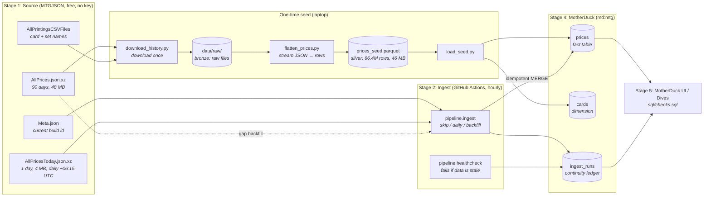

# MTG Card Price Pipeline

A CS 452 data pipeline that bulk-loads 90 days of Magic: The Gathering card prices
(66M rows), then keeps itself current on a schedule, with no one pushing the button.

**Stack:** MTGJSON → GitHub Actions (hourly cron) → MotherDuck (cloud DuckDB) → MotherDuck UI / Dives

## Architecture



Stage 3 (buffer/stream) is skipped on purpose. The source publishes one file a day,
so a queue would add a moving part with nothing to decouple.

## Choices and why

| Stage | Choice | Why |
|---|---|---|
| Source | MTGJSON prices | Personal interest. 66M rows of history plus a daily feed, open data, no API key. Covers 5 vendors (TCGplayer, Card Kingdom, Cardmarket, ManaPool, Cardhoarder), retail and buylist, normal and foil. |
| Cadence | Poll **hourly**, data changes **daily** | The source updates once a day, so faster ingestion is pointless. Polling hourly means a skipped GitHub run delays data by an hour, not a day. Polls that find nothing only fetch `Meta.json` (~100 bytes). |
| Ingest | GitHub Actions cron | Runs with the laptop closed, the schedule is version-controlled, and it's free on a public repo. |
| Store | MotherDuck | Cloud DuckDB: columnar, fast on 66M rows, and the free Lite tier (10 GB) fits easily. The same SQL runs locally (`data/mtg.duckdb`) and in the cloud (`md:mtg`), so development was offline. |
| Show | MotherDuck UI / Dives | Built in, so there's no extra service to connect. |

**Seed vs. trickle.** These are two different paths. The seed downloads the 90-day history
*once*, saves the raw file, flattens it to parquet, and bulk-loads from disk. The hourly
job only ever fetches `Meta.json` and, once a day, the 4 MB daily file.

## Requirements

**1. Idempotency.** The natural key is `(uuid, format, provider, price_type, finish, price_date)`.
Every load goes through one MERGE (`pipeline/store.py`): new keys are inserted, keys whose price
changed are updated, and identical rows are left alone. There's no PK constraint, because analytical
stores don't enforce them and an index over 66M composite keys would cost GBs. Uniqueness is checked
with `sql/checks.sql` #3 instead.
- Re-merging an already-loaded day gave **0 inserted, 764,886 unchanged, 85 updated**.
- Those 85 were real same-day revisions: MTGJSON's history file and daily file, built a minute
  apart, disagreed on some Card Kingdom and ManaPool prices (one foil went from $149.99 to $5.99).
  So "insert if not exists" would have been *wrong*, because it freezes the first value. We use
  last-write-wins, with `loaded_at` and `run_id` recording which run changed each row.

**2. Gaps and failures.**
- *Seed/trickle seam:* the seed ends at the 2026-11-12 build, and the daily file for that build
  is the same day. The overlap is absorbed by the MERGE.
- *Missed runs:* if the newest stored day is more than 1 day behind the current build (runner
  outage, MTGJSON down at 3 a.m.), the job switches to **backfill**. It pulls the 90-day history
  file and merges every missing day. We backfill instead of skipping because the history file
  makes recovery free, for up to 90 days.
- *Tested by simulation:* deleted 1 day → daily path inserted 764,971. Deleted 3 days → backfill
  inserted 2,293,838. Final table back to exactly 66,373,196 rows = 66,373,196 distinct keys.
- *Failures* are written to `ingest_runs` with the error message, and the job exits non-zero
  (red ❌ in Actions, plus an email). `pipeline.healthcheck` also fails if the newest data is
  more than 2 days old or no run happened in 6 hours. That catches the "green but writing nothing" failure.

**3. Secrets.** The MotherDuck token lives in the GitHub Actions secret `MOTHERDUCK_TOKEN`.
Locally it's read from a gitignored `secrets.json` into the process environment. It's never
printed or committed.

**4. Cost.** $0. GitHub Actions is free for public repos, MotherDuck is on the free Lite tier
(10 GB storage, 10 compute-hours/month), and MTGJSON is free. Actual spend is reported from the
MotherDuck billing page in the demo.

## Lessons learned
- **Managed services lag the engine.** MotherDuck rejected DuckDB 2.0 ("latest supported
  v1.5.6"), so `duckdb` is pinned. A 2.0-written database file can't be opened by 1.5.6,
  but it didn't matter: everything is rebuilt from the raw files in `data/raw/`.
- **Timezones.** The laptop is in Mountain time and GitHub runners are in UTC, so every
  connection sets `TimeZone = 'UTC'` to keep the run ledger consistent.
- **Spill to disk.** Deduplicating 66M rows needs more memory than DuckDB will use, so it
  spills to a temp folder named after the database path. For `md:mtg` that's `md:mtg.tmp`,
  which isn't a valid Windows folder name, so the first cloud seed failed with 0 rows loaded.
  `temp_directory` is now set explicitly. The failed attempt is still recorded in `ingest_runs`.
- **Streaming parse.** The 90-day JSON is ~1 GB uncompressed. `ijson` streams it card by
  card, so memory stays flat.

## Run it

```bash
python -m venv .venv && .venv/Scripts/pip install -r requirements.txt
python seed/download_history.py      # once: raw files -> data/raw/
python seed/flatten_prices.py        # JSON -> parquet
MTG_DB=md:mtg python seed/load_seed.py
MTG_DB=md:mtg python -m pipeline.ingest
```
